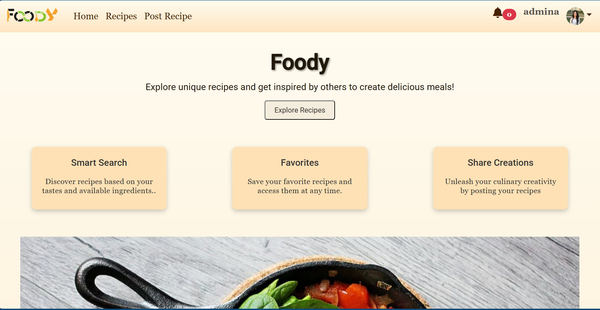
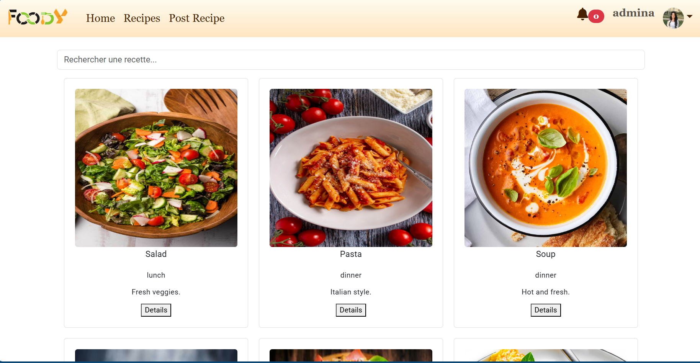
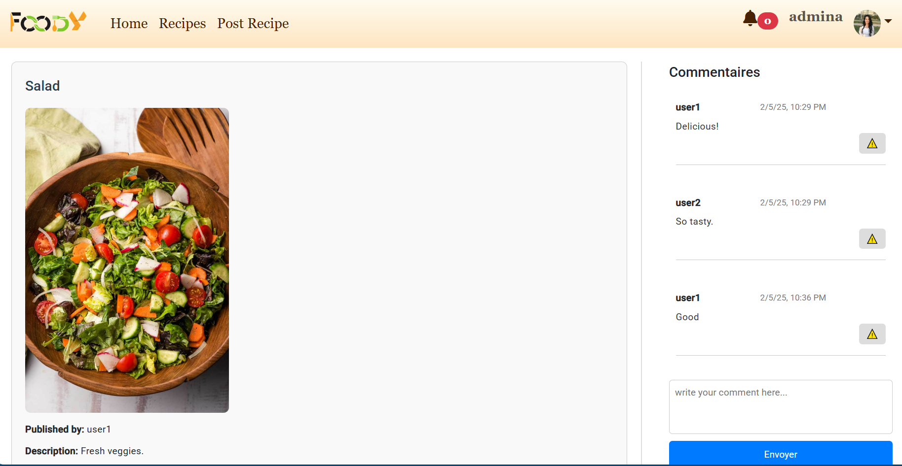
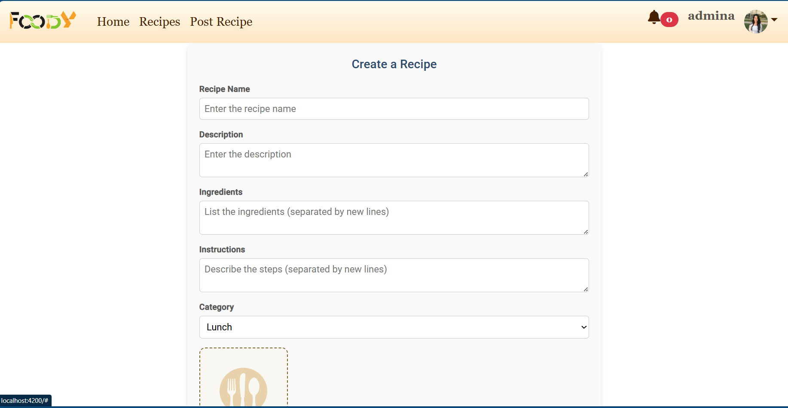

# 🍲 Foody App

Foody is a **full-stack web application** built with **NestJS (backend)** and **Angular (frontend)**.  
It allows users to create, share, and manage recipes, while admins can moderate submissions and manage users.  

---

## 📌 Features

### 👤 User
- Sign up & login (JWT authentication).
- Create, update, and delete their recipes.
- Upload a profile picture.
- Save favorite recipes.
- Manage their profile information.

### 🛡️ Admin
- Manage users (create, update, delete).
- Review submitted recipes and approve/reject them.
- Has all user permissions + extra admin controls.

### 📖 Recipes
- Add / edit / delete recipes.
- View recipes by category.
- Only approved recipes are displayed publicly.

---

## 🏗️ Project Structure

````
Foody\_app/
│── foody\_backend/   # NestJS backend
│── foody\_frontend/  # Angular frontend
│── README.md        # Project documentation

````

---

## ⚙️ Tech Stack

- **Backend**: [NestJS](https://nestjs.com/), TypeORM, PostgreSQL, Passport (JWT Auth)  
- **Frontend**: [Angular](https://angular.io/), TailwindCSS, Angular Material  
- **Database**: PostgreSQL  
- **Other tools**: Multer (file upload), class-validator, class-transformer  

---

## 🚀 Getting Started

### 1️⃣ Clone the repository
```bash
git clone https://github.com/your-username/foody_app.git
cd foody_app
````

---

### 2️⃣ Backend Setup (NestJS)

```bash
cd foody_backend
npm install
```

Create a `.env` file in `foody_backend/` with the following variables:

```env
APP_ENV=dev
PORT=3000

DB_HOST=localhost
DB_PORT=5432
DB_USERNAME=postgres
DB_PASSWORD=yourpassword
DB_NAME=foody_db

JWT_SECRET=supersecret
JWT_EXPIRATION=3600s
```

Run the backend:

```bash
npm run start:dev
```

The API will be available at: **[http://localhost:3000](http://localhost:3000)**

---

### 3️⃣ Frontend Setup (Angular)

```bash
cd foody_frontend
npm install
```

Run the Angular app:

```bash
ng serve
```

The frontend will be available at: **[http://localhost:4200](http://localhost:4200)**

---

## 📚 API Documentation

We use **Swagger** for API documentation.

* Once the backend is running, visit:
  👉 **[http://localhost:3000/api](http://localhost:3000/api)**

---

## 📂 Modules Overview (Backend)

### 🔑 AuthModule

* Handles user authentication & authorization with JWT.
* Guards, strategies, and login/signup endpoints.

### 👤 UserModule

* Manage users: profile, password update, avatar upload.
* CRUD operations for users.

### 🍴 RecipeModule

* Add, edit, delete, and list recipes.
* Recipes linked to users.
* Status (pending / approved / rejected).

### 🛡️ AdminModule

* Approve or reject submitted recipes.
* Manage user accounts.

### ⚙️ SharedModule

* Reusable interceptors, pipes, guards, and services.

---

## 📂 Angular App Structure (Frontend)

### Core Pages

* **Home**: Landing page with featured recipes.
* **Login / Signup**: User authentication.
* **Recipes**: Browse all approved recipes.
* **Dashboard**: User profile, saved recipes, and created recipes.
* **Add/Edit Recipe**: Form to create or edit a recipe.
* **Admin Panel**: For admins to manage recipes & users.

---

## 🧪 Testing

Run backend unit tests:

```bash
cd foody_backend
npm run test
```

---

## 📸 Screenshots 

### 🏠 Home Page


###  Recipes


### Recipe Details


### Create Recipe 



